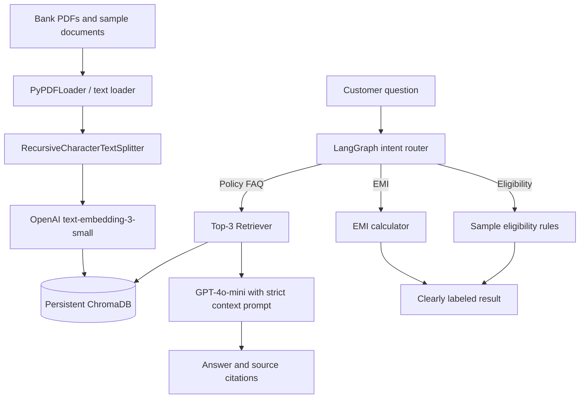
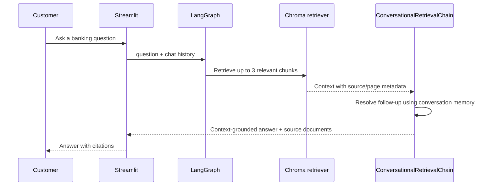

# AI Banking Customer Support & Loan Advisor

A Streamlit banking assistant that retrieves passages from locally indexed
banking documents before answering policy questions. It combines LangChain,
GPT-4o-mini, OpenAI embeddings, persistent ChromaDB, conversational memory,
deterministic banking tools, and a LangGraph intent workflow.

> **Important:** The bundled Markdown documents are fictional training samples,
> not official banking policies or financial advice. Replace them with approved,
> current documents before any real customer use. EMI is an estimate and the
> sample eligibility rules are not a lending decision.

## Architecture



## RAG Flow



Policy answers are prompted to use retrieved context only and to return a fixed
fallback when evidence is missing. Source filenames and PDF page numbers are
formatted from loader metadata. Calculations and the requested illustrative
eligibility rules are tool outputs, not claims sourced from a bank document.

## LangChain Components

- `PyPDFLoader` plus Markdown/text loading for included training material.
- `RecursiveCharacterTextSplitter` with 500-character chunks and 50-character overlap.
- `OpenAIEmbeddings` using `text-embedding-3-small` and persistent ChromaDB.
- Top-3 retriever; `RetrievalQA` for single-turn use and
	`ConversationalRetrievalChain` with `ConversationBufferMemory` for follow-ups.
- LangChain tools for EMI, sample eligibility, FAQ retrieval, and targeted document search.
- `create_tool_calling_agent` and `AgentExecutor` are available in `agent.py`;
	the Streamlit workflow uses the explicit LangGraph classifier/router.

## Installation

Use Python 3.11. From the repository root:

```bash
python3.11 -m venv .venv
source .venv/bin/activate
python -m pip install --upgrade pip
pip install -r requirements.txt
cp .env.example .env
```

Set `OPENAI_API_KEY` in `.env`, or enter it in the app's sidebar. The key is
needed for both embeddings and GPT-4o-mini. Never commit `.env`.

## Run Streamlit

```bash
streamlit run app.py
```

Upload approved PDFs in the sidebar and select **Build / refresh index**. The
bundled sample corpus is indexed alongside uploaded files. Chroma persists to
`chroma_db/`, which is intentionally ignored by Git. Ask policy questions in
the main panel; the conversation and its LangChain memory remain available for
follow-up questions during that Streamlit session.

## Sample Screen

The app opens directly to its working chat interface. Its initial state has a
document upload/index control in the sidebar and a question form below the chat:

```text
┌──────────────────────────┬──────────────────────────────────────────────┐
│ Document index           │ AI Banking Assistant                         │
│ OpenAI API key           │ Customer support and loan guidance...        │
│ [Upload banking PDFs]    │                                              │
│ [Build / refresh index]  │ Ask a banking question                       │
│                          │ [What documents are needed for a home loan?] │
│                          │ [Ask AI]                                     │
└──────────────────────────┴──────────────────────────────────────────────┘
```

## Example Questions

- What documents are required for a home loan?
- What is the interest rate for a personal loan?
- How can I block my debit card?
- What is the minimum account balance?
- Explain EMI. What happens if I miss an EMI?
- Calculate EMI for ₹10 lakh loan for 5 years at 9%.
- Am I eligible for a loan if my salary is ₹60,000 and existing EMI is ₹10,000?

## Tests

```bash
pytest -q
```

The unit tests cover document loading, retrieval/citation formatting, EMI,
eligibility validation, natural-language tool routing, and the LangGraph workflow.
They do not make OpenAI API calls.

## Project Structure

```text
app.py
agent.py
state.py
document_loader.py
text_splitter.py
vector_store.py
retriever.py
rag_chain.py
tools/
	emi_tool.py
	eligibility_tool.py
	faq_tool.py
	document_search_tool.py
data/documents/       # Fictional Markdown samples; upload PDFs in the app
tests/
chroma_db/            # Created locally when indexing
requirements.txt
```

## Future Enhancements

- Add authenticated, role-aware document sources and version/expiry checks.
- Add access controls, encryption, retention limits, and audit trails before handling customer data.
- Evaluate retrieval quality and answer faithfulness against approved bank policy tests.
- Add document deletion/reindex controls, source-level metadata filters, and observability.
- Replace illustrative eligibility logic with a bank-approved decision service.